<!-- SPDX-FileCopyrightText: 2026 Lars Greiss / LG Aquatic Life -->
<!-- SPDX-License-Identifier: GPL-3.0-or-later -->

# LGAL Doser – Bedienungsanleitung

*[English](../user-guide.md) · Deutsch*

Diese Anleitung erklärt Einrichtung und Bedienung der Dosierpumpe für den Alltag am Aquarium.
Wie das Gerät gebaut wird, steht in der [Nachbau-Anleitung](nachbau.md), technische Details
(API, MQTT-Topics, Interna) in der [technischen Dokumentation](technik.md).

> **Dosierfehler können Tiere töten.** Bitte vor dem ersten Einsatz den Abschnitt
> [Sicherheit](#1-sicherheit) lesen und neue Einstellungen immer erst ohne Tiere bzw. mit
> kleinen Mengen und häufigen Wassertests prüfen.

## Inhalt

1. [Sicherheit](#1-sicherheit)
2. [Aufstellen und anschließen](#2-aufstellen-und-anschließen)
3. [Ersteinrichtung](#3-ersteinrichtung)
4. [Anmelden](#4-anmelden)
5. [Die Oberfläche](#5-die-oberfläche)
6. [Eine Pumpe einrichten](#6-eine-pumpe-einrichten)
7. [Im Alltag](#7-im-alltag)
8. [Einstellungen](#8-einstellungen)
9. [Updates und Wartung](#9-updates-und-wartung)
10. [Taster und Status-LED](#10-taster-und-status-led)
11. [Wenn etwas nicht geht](#11-wenn-etwas-nicht-geht)

---

## 1. Sicherheit

- **Mengen begrenzen:** Für jede Pumpe ein Tageslimit setzen (Ansicht Profi, Pumpe →
  Einstellungen), das eine gefährliche Menge sicher ausschließt. Behälter nicht größer wählen
  als nötig.
- **Kontrollieren:** Nach jeder Änderung an Schlauch, Behälter, Zeitplan oder Firmware die
  Pumpe neu kalibrieren bzw. die Menge prüfen und die Wasserwerte in den folgenden Tagen öfter
  messen.
- **Schläuche richtig führen:** Die Schlauchenden im Becken oberhalb des Wasserspiegels
  befestigen oder ein Rückschlagventil verwenden, damit nichts zurück- oder nachläuft.
  Schläuche nicht vertauschen – Pumpe 1 ist von vorne gesehen die linke.
- **Strom und Wasser:** Gerät und Netzteil spritzwassergeschützt und oberhalb des Beckens
  aufstellen, Kabel mit Tropfschlaufe verlegen, Netzteil an einer Steckdose mit
  Fehlerstrom-Schutzschalter (FI) betreiben. Nur das vorgesehene 24-V-Netzteil verwenden.
- **Vor Arbeiten am Gerät** (Schlauch wechseln, Pumpe tauschen) den Betrieb der Pumpe auf
  „aus“ stellen oder das Netzteil ziehen.

## 2. Aufstellen und anschließen

1. Gerät oberhalb des Wasserspiegels aufstellen, die Behälter daneben oder darunter.
2. Pro Pumpe den Ansaugschlauch in den Behälter führen und das Ende des Druckschlauchs am
   Becken befestigen (siehe oben). Die Pumpen sind auf dem Gehäuse nummeriert.
3. LAN-Kabel einstecken (empfohlen). WLAN geht auch, wird aber erst bei der Einrichtung
   festgelegt.
4. Zuletzt das Netzteil anschließen. Die LED blendet weiß auf und zeigt dann, was das Gerät
   tut (siehe [Status-LED](#10-taster-und-status-led)).

Auf dem **Typenschild** des Geräts stehen der Name des Setup-WLANs und das **Geräte-Passwort**.
Beides wird für die Einrichtung und für den Notfall gebraucht – Typenschild nicht entfernen.

## 3. Ersteinrichtung

Ein neues Gerät öffnet dafür ein eigenes WLAN, das Setup-WLAN (LED weiß, langsam pulsierend).

1. Mit Handy oder Laptop das WLAN **`LG-Aquatic-Life-Setup-XXXX`** wählen und das
   Geräte-Passwort vom Typenschild eingeben.
2. Meist öffnet sich die Einrichtung von selbst. Sonst im Browser `http://192.168.4.1/`
   aufrufen.
3. Der Assistent führt durch fünf Schritte:
   - **Sprache** (Deutsch, Englisch, Französisch, Spanisch, Italienisch, Niederländisch,
     Polnisch, Türkisch oder Chinesisch),
   - **eigenes Admin-Passwort** (8–64 Zeichen): einmal das Geräte-Passwort vom Typenschild
     eingeben, dann ein eigenes Passwort wählen – ab jetzt meldet nur noch dieses an,
   - einmal mit dem neuen Passwort **anmelden** (Benutzer „admin“); dein Browser kann es sich
     dabei merken. Danach geht es weiter mit
   - **Netzwerk:** LAN-Status prüfen oder ein WLAN suchen, testen und speichern,
   - **Zeitzone** und Zeitserver, bei Bedarf die Uhrzeit vom Browser übernehmen,
   - **Abschluss.**

   Bis die Einrichtung abgeschlossen ist, macht das Gerät nichts anderes – keine Pumpe lässt sich
   starten. Brichst du zwischendurch ab, kommst du nach dem Anmelden wieder in die Einrichtung.
4. Nach dem Abschluss zeigt die Seite die neue Adresse des Geräts, z. B.
   `http://lgal-doser-xxxx.local/`, und die IP-Adresse. 20 Sekunden später schaltet sich das
   Setup-WLAN ab. Handy oder Laptop wieder mit dem Heimnetz verbinden und die neue Adresse
   öffnen.

Die Einrichtung Schritt für Schritt:

<table>
<tr>
<td align="center" width="33%"> 1. Sprache</td>
<td align="center" width="33%">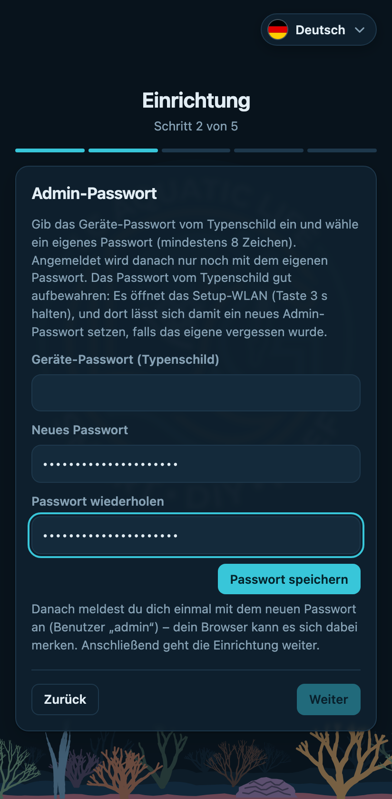 2. Eigenes Passwort</td>
<td align="center" width="33%">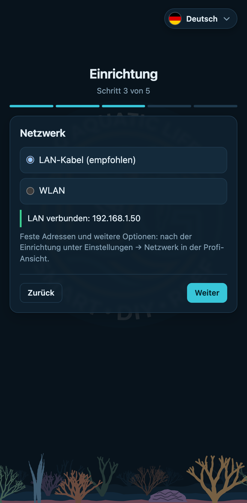 3. Netzwerk (LAN)</td>
</tr>
<tr>
<td align="center" width="33%">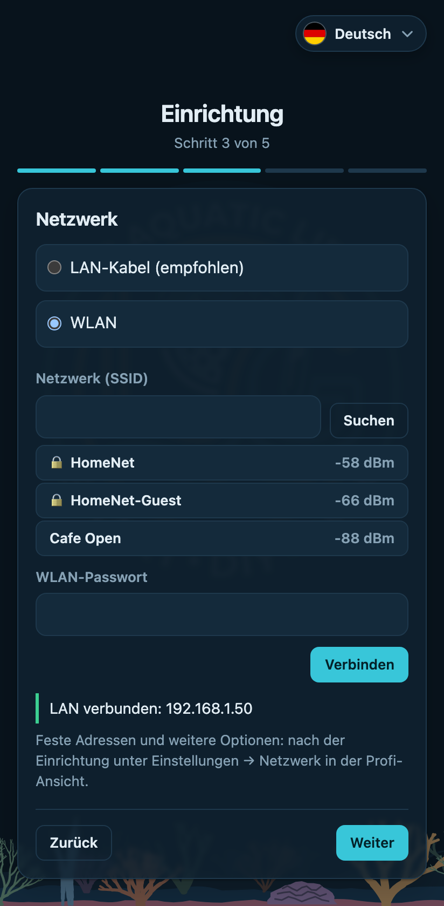 3. Netzwerk (WLAN)</td>
<td align="center" width="33%">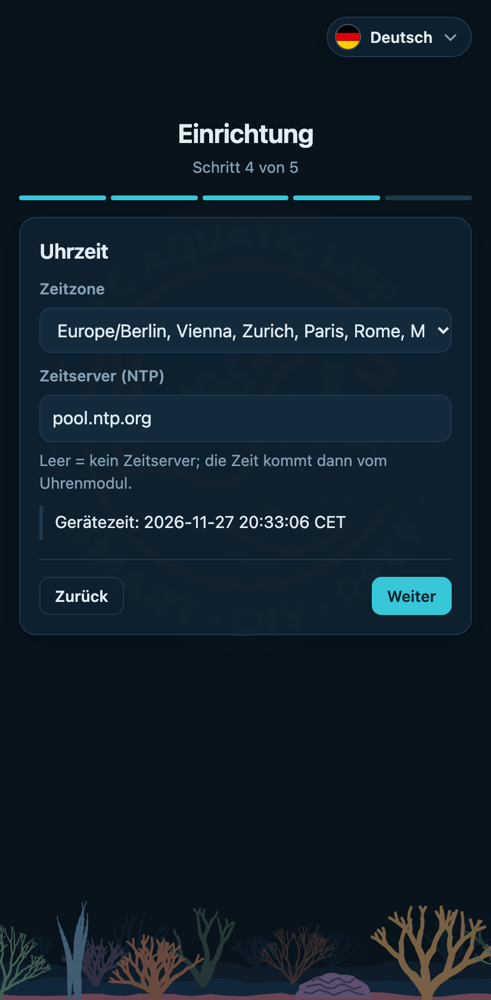 4. Zeitzone</td>
<td align="center" width="33%">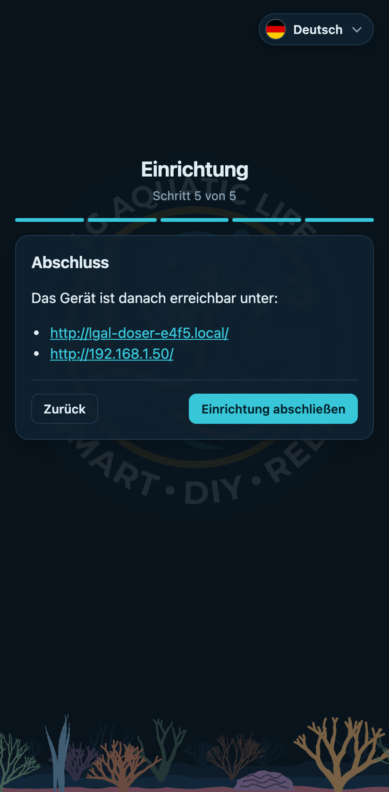 5. Abschluss</td>
</tr>
</table>

Tipp: Die Adresse als Lesezeichen speichern oder auf den Home-Bildschirm des Handys legen (dort
erscheint sie mit dem Tropfen-Icon). Funktioniert `….local` nicht (manche Android-Geräte), die
IP-Adresse verwenden; sie steht auch in der Geräteliste des Routers.

## 4. Anmelden

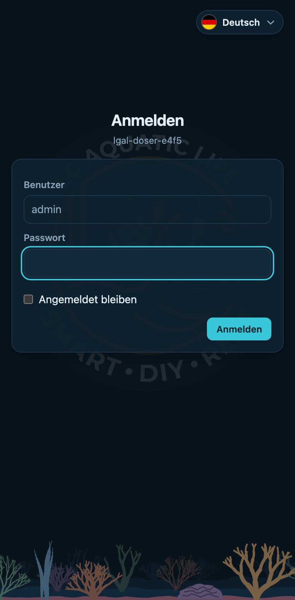

- Angemeldet wird als Benutzer **admin** mit dem eigenen **Admin-Passwort**. Der Browser bleibt
  angemeldet, solange er mindestens einmal pro Woche benutzt und nicht geschlossen wird (höchstens
  30 Tage). Nach einem Neustart oder Update des Geräts muss man sich neu anmelden.
- Mit **Angemeldet bleiben** bleibt der Browser 90 Tage nach dem letzten Besuch angemeldet, auch
  wenn er geschlossen wird und nach einem Neustart oder Update. Nur auf eigenen Geräten anhaken.
- **Überall abmelden** (Einstellungen → Anmeldung) meldet jeden Browser ab, zum Beispiel nach dem
  Verlust eines Handys. Apps und Home Assistant mit API-Schlüssel bleiben verbunden.
- Nach fünf falschen Versuchen wartet das Gerät vor jedem weiteren Versuch, erst kurz, dann
  immer länger (bis 5 Minuten).
- **Passwort vergessen:** siehe [Wenn etwas nicht geht](#11-wenn-etwas-nicht-geht).
- Passwort ändern, Abmelden und Überall abmelden: Einstellungen → Anmeldung.

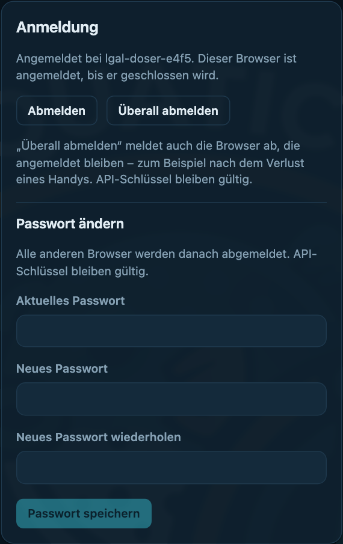

## 5. Die Oberfläche

Oben rechts wählt man die Ansicht:

- **Einfach** zeigt alles, was man im Alltag braucht.
- **Profi** zeigt zusätzlich detaillierte Zeitpläne, Feineinstellungen der Pumpen,
  Sperrzeiten zwischen Pumpen, Netzwerk- und MQTT-Einstellungen, die Ereignisliste und
  API-Schlüssel.

Was in Profi eingestellt ist, bleibt in Einfach aktiv. Die Ansicht wird pro Browser gemerkt.

Die Seiten:

| Seite | Inhalt |
|---|---|
| **Übersicht** | eine Karte pro Pumpe mit Behälter, heute dosiert / geplant, Reichweite und nächster Dosis |
| **Pumpe** (Karte antippen) | Behälter, Alarme und Warnungen, jetzt dosieren, Kalibrieren (mit Schlauch füllen), Zeitplan, Boost, Verbrauch, Einstellungen |
| **Verlauf** | dosierte Mengen pro Tag als Diagramm; in Profi alle Ereignisse mit Filter und CSV-Export |
| **Einstellungen** | Gerät, Uhrzeit, Status-LED, Netzwerk, MQTT, Anmeldung, Darstellung; von hier zur **Wartung** |

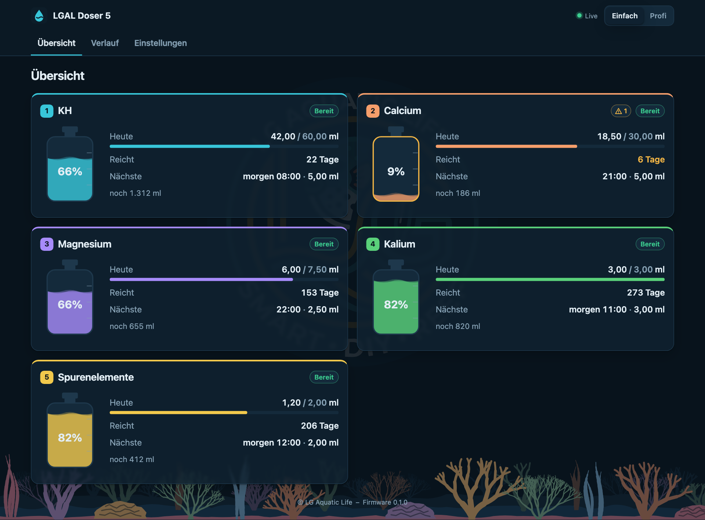

Eine Pumpenkarte in der Übersicht:

- **Behälter-Grafik:** Füllstand in Prozent. Der Rand wird **gelb**, wenn der Vorrat weniger
  Tage reicht als die Warnschwelle (Standard 7 Tage), und **rot** unter der Alarmschwelle
  (Standard 4 Tage). Gestrichelt = ohne Behälter-Erfassung.
- **Heute:** bereits dosiert / für heute geplant. Türkis bei laufendem Boost.
- **Reicht:** wie viele Tage der Vorrat beim aktuellen Zeitplan noch reicht.
- **Nächste:** Zeitpunkt und Menge der nächsten geplanten Dosis.
- **Symbole neben dem Status:** Anzahl der Alarme (rot) und Warnungen (gelb), ein Pfeil bei
  laufendem Boost. Die Texte dazu stehen auf der Pumpenseite.

## 6. Eine Pumpe einrichten

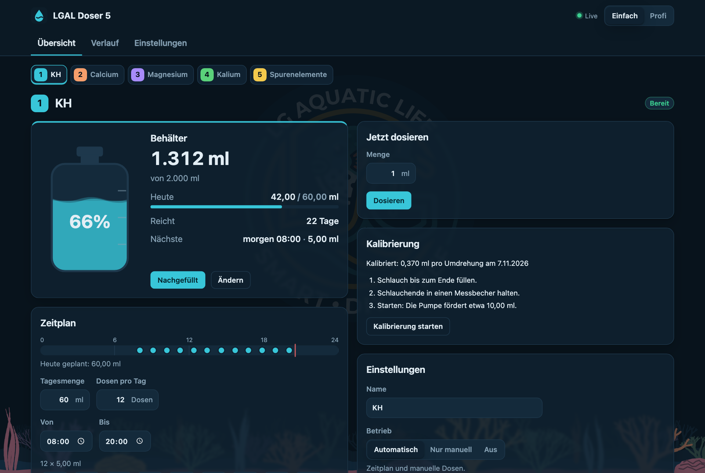

Für jede Pumpe in dieser Reihenfolge:

### 6.1 Name und Betrieb

Pumpe → Einstellungen: **Name** (z. B. „KH“, „Calcium“) und **Betrieb**:

| Betrieb | Bedeutung |
|---|---|
| automatisch | der Zeitplan läuft, manuelles Dosieren geht auch |
| nur manuell | kein Zeitplan, nur Dosieren von Hand |
| aus | die Pumpe läuft gar nicht und meldet keine Alarme |

### 6.2 Behälter eintragen

Auf der Behälter-Karte **Ändern**: Größe des Behälters in ml. Ein neu eingetragener Behälter
gilt als voll. Nach dem Nachfüllen genügt **Nachgefüllt** (oder **Ändern**, wenn der Behälter
nicht ganz voll ist). Größe 0 schaltet die Behälter-Erfassung ab.

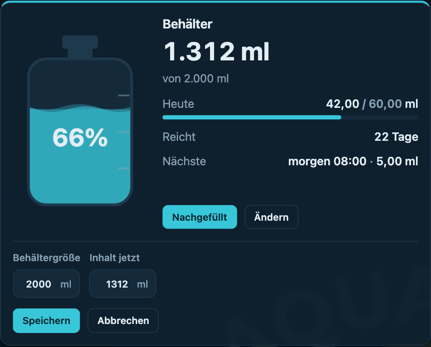

Das Gerät zieht jede Dosis und das Kalibrieren vom Behälter ab und
berechnet daraus die Reichweite. Der Füllstand ist eine Rechnung und nur so genau wie
Kalibrierung und Eingaben. Wird der Vorrat knapp, färbt sich die Reichweite gelb und die Pumpe
warnt, siehe [Alarme und Warnungen](#alarme-und-warnungen).

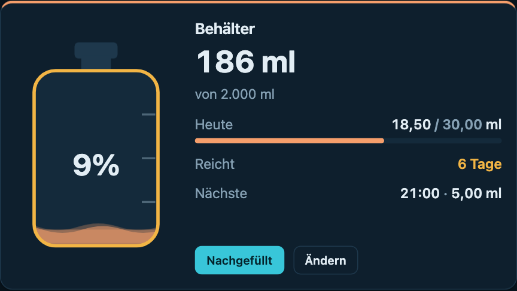

### 6.3 Schlauch füllen

Kalibrierung → **Kalibrierung starten** öffnet den Assistenten; dort **Halten zum Füllen**
gedrückt halten, bis die Flüssigkeit am Schlauchende ankommt. Die Pumpe läuft nur, solange der
Knopf gehalten wird, und stoppt sofort beim Loslassen oder wenn die Verbindung abreißt
(höchstens 60 Sekunden am Stück). Wer nur füllen will, schließt den Assistenten danach mit
**Abbrechen**. Woanders gibt es den Knopf nicht, damit niemand aus Versehen eine Pumpe laufen
lässt.

### 6.4 Kalibrieren

Ohne Kalibrierung rechnet die Pumpe mit einem Nennwert, der je nach Schlauch deutlich
abweichen kann. **Darum jede Pumpe vor dem Einsatz kalibrieren.**

1. **Kalibrieren** starten. Der Assistent fragt, ob der Schlauch gefüllt ist, und bietet das
   Füllen direkt an.
2. Das Schlauchende in einen Messbecher (am besten eine Spritze oder einen Messzylinder mit
   0,1-ml-Teilung) halten. Die Pumpe fördert die Zielmenge (Standard 10 ml).
3. Die **tatsächlich gemessene Menge** eintragen und übernehmen – oder verwerfen.

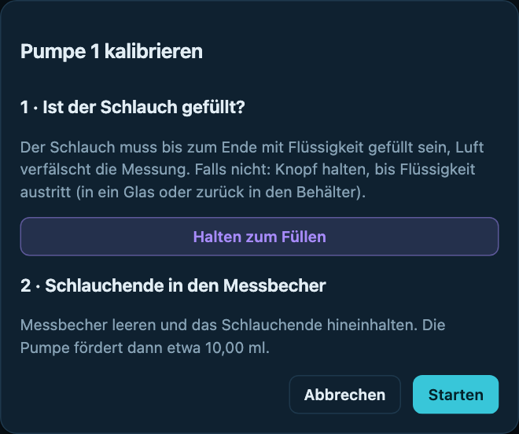

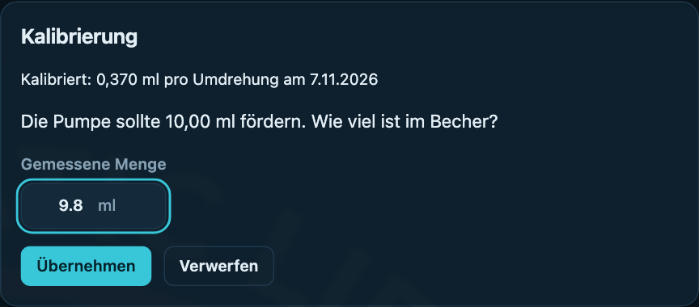

Die Pumpe erinnert an eine neue Kalibrierung (einstellbar: aus, 3, 6, 9 oder 12 Monate,
Standard 3). Nach einem Schlauchwechsel immer neu kalibrieren.

### 6.5 Zeitplan

Jede Pumpe hat genau einen Zeitplan. Die 24-Stunden-Leiste zeigt die Dosen von heute.

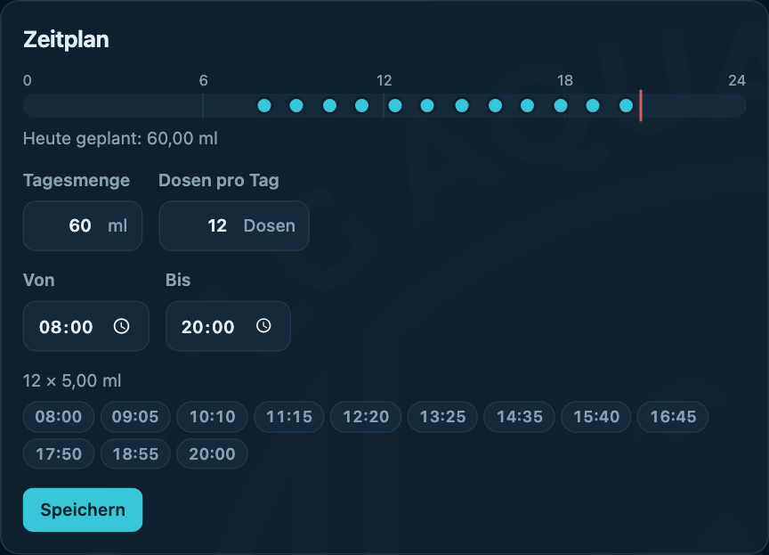
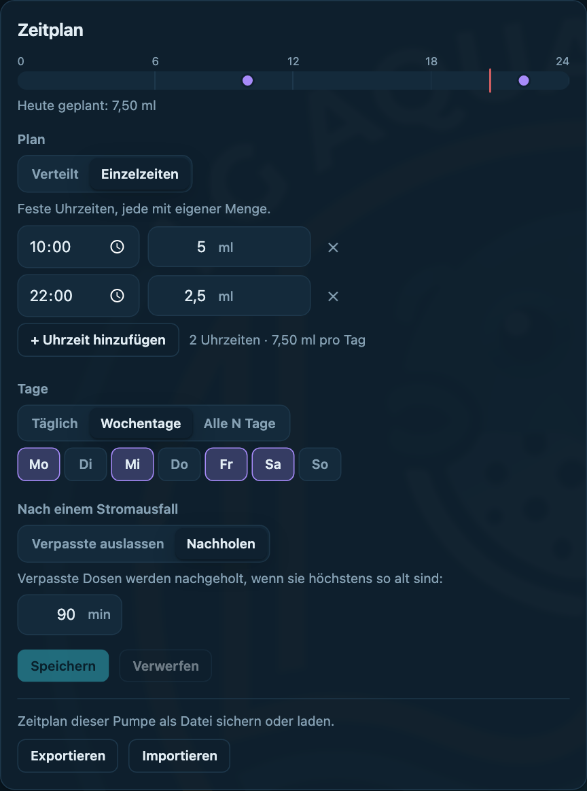

- **Einfach:** Tagesmenge, Anzahl der Dosen und zwei Uhrzeiten, z. B. „24 ml in 12 Dosen
  zwischen 08:00 und 20:00“, täglich. Die Vorschau zeigt die Uhrzeiten.
- **Profi:** zusätzlich „Einzelzeiten“ (bis 24 Uhrzeiten mit eigener Menge), Wochentage oder
  „alle N Tage“ und das Verhalten nach einem Stromausfall (verpasste Dosen auslassen oder in
  einem Zeitfenster nachholen).

Beim Speichern prüft das Gerät alle Pumpen zusammen: Dosen dürfen sich nicht überschneiden,
das Tageslimit nicht überschreiten und keine Sperrzeit verletzen. Konflikte werden mit
Uhrzeit genannt, gespeichert wird dann nichts.

Ein Zeitplan läuft nur bei Betrieb **automatisch** und nur mit gültiger Uhrzeit. In Profi
lässt er sich als Datei exportieren und auf derselben oder einer anderen Pumpe importieren.

### 6.6 Feineinstellungen (Profi)

Pumpe → Einstellungen in Profi:

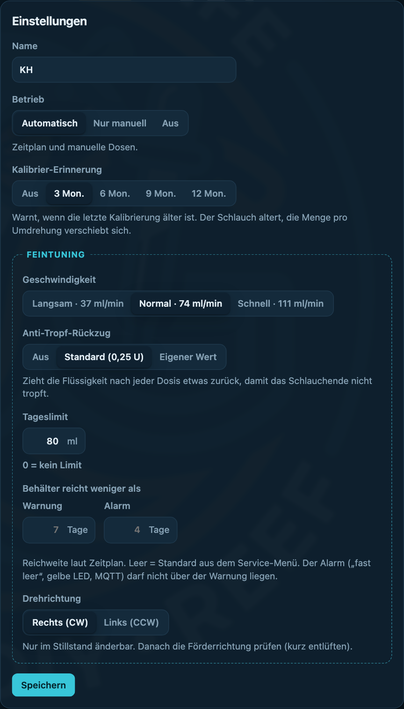

- **Tageslimit:** harte Obergrenze pro Tag für alle Dosen zusammen. Eine Dosis, die darüber
  ginge, wird ausgelassen und gemeldet. **Dringend empfohlen.**
- **Geschwindigkeit** beim Dosieren (drei Stufen).
- **Rückzug:** zieht nach jeder Dosis ein wenig zurück, damit nichts nachtropft (ab Werk aus).
- **Warn- und Alarmschwelle** des Behälters in Tagen Reichweite.
- **Drehrichtung** von vorne gesehen, ab Werk rechts herum, falls die Pumpe falsch herum fördert
  (nur im Stillstand; danach im Kalibrier-Assistenten kurz füllen und die Richtung prüfen).

Die Zielmenge der Kalibrierung lässt sich in Profi direkt im Kalibrier-Assistenten ändern.

### 6.7 Schlauch wechseln

Pumpenschläuche verschleißen. Das Gerät zählt die Betriebsstunden pro Pumpe (Pumpe →
Verbrauch) und warnt, wenn die Lebensdauer erreicht ist. Nach dem Wechsel in Profi
**Schlauch getauscht** drücken und die Pumpe neu kalibrieren.

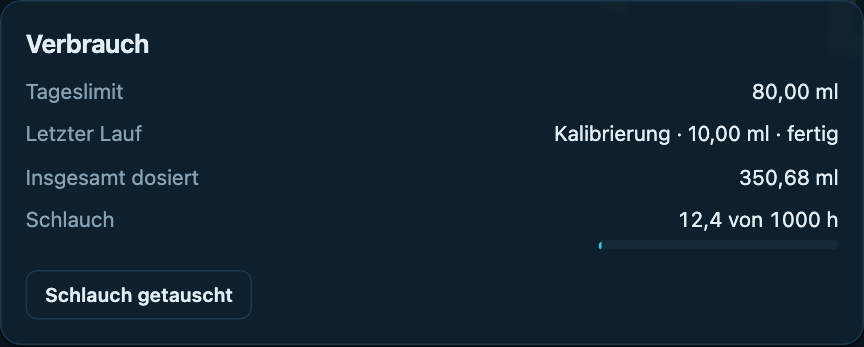

## 7. Im Alltag

### Jetzt dosieren

Pumpe → **Jetzt dosieren**: Menge eingeben, starten; Fortschritt und **Stopp** werden
angezeigt. Liegt die Pumpe gerade in einer Sperrzeit, nennt die Seite, wann es wieder geht, oder
die Dosis startet danach, je nach Einstellung. Bei **Nachfragen** wählst du: abbrechen, nach der
Sperrzeit dosieren oder trotzdem dosieren (der Verlauf vermerkt das).

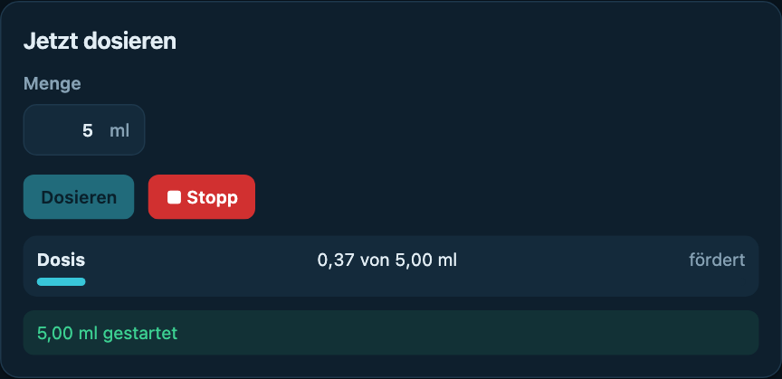

### Boost

Für eine begrenzte Zeit mehr dosieren, z. B. nach einem Wasserwechsel: Pumpe → **Boost**,
Zusatzmenge und Zeitraum (1–30 Tage) wählen. Die Menge wird gleichmäßig auf die geplanten
Dosen verteilt; die Vorschau zeigt „≈ X ml zusätzlich pro Tag“. In Profi geht auch „über die
nächsten N Dosen“. Ein Boost endet von selbst und lässt sich vorher beenden. Er braucht einen
Zeitplan und Betrieb „automatisch“.

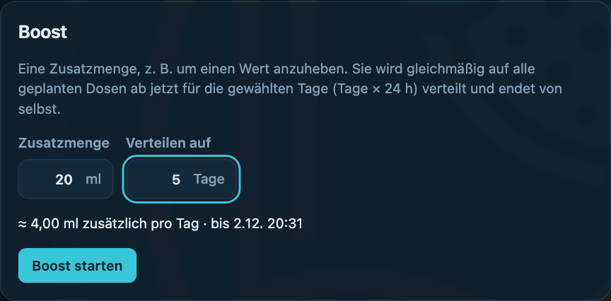

### Alarme und Warnungen

| Meldung | Bedeutung, was tun |
|---|---|
| Behälter fast leer | Vorrat reicht nur noch wenige Tage → nachfüllen |
| Tageslimit erreicht | eine Dosis wurde ausgelassen → Zeitplan und Limit prüfen |
| Treiberfehler im letzten Lauf | Motor oder Kabel prüfen; tritt es wieder auf: Pumpe auf „aus“ |
| Kalibrierung fehlt / zu alt | Pumpe kalibrieren |
| Neuer Schlauch – neu kalibrieren | nach „Schlauch getauscht“ |
| Schlauch-Lebensdauer erreicht | Pumpenschlauch tauschen |
| Ausgelassene Dosen | z. B. nach einem Stromausfall; Grund steht im Verlauf |
| Keine gültige Uhrzeit | Zeitpläne pausieren; Netz/Zeitserver prüfen oder Uhrzeit setzen |

### Verlauf

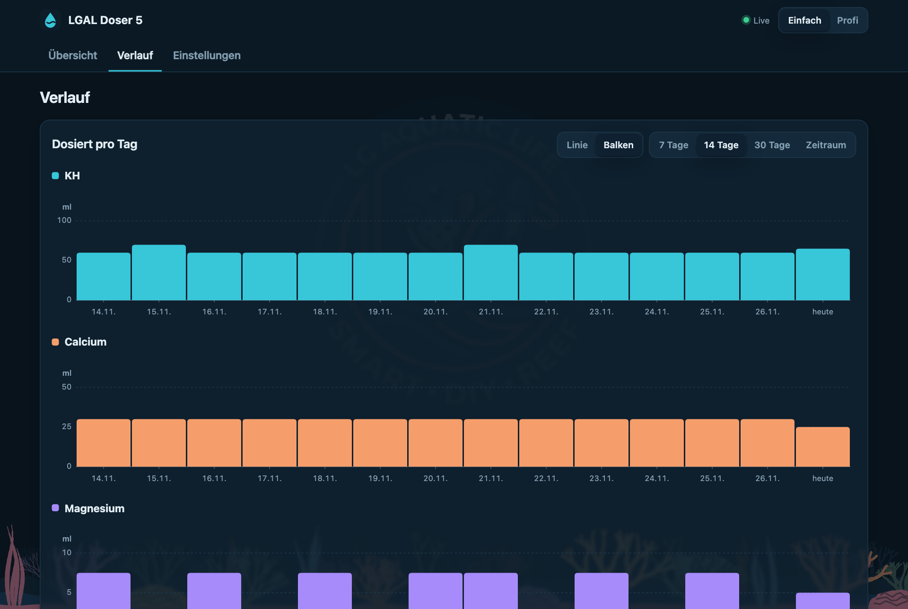

**Verlauf** zeigt die dosierte Menge pro Tag und Pumpe für 7, 14 (Standard) oder 30 Tage oder
mit **Zeitraum** für beliebige Tage, die das Gerät noch aufbewahrt (von – bis; 30 bis 90 Tage,
eingestellt im Engineering-Bereich), als Balken oder Linie. Antippen eines Tages nennt Menge, Anzahl der Dosen und ausgelassene Dosen.
In Profi gibt es die Liste aller Ereignisse (Dosen, Füllen, Kalibrierung, Alarme, Änderungen …)
mit Filter und CSV-Export.

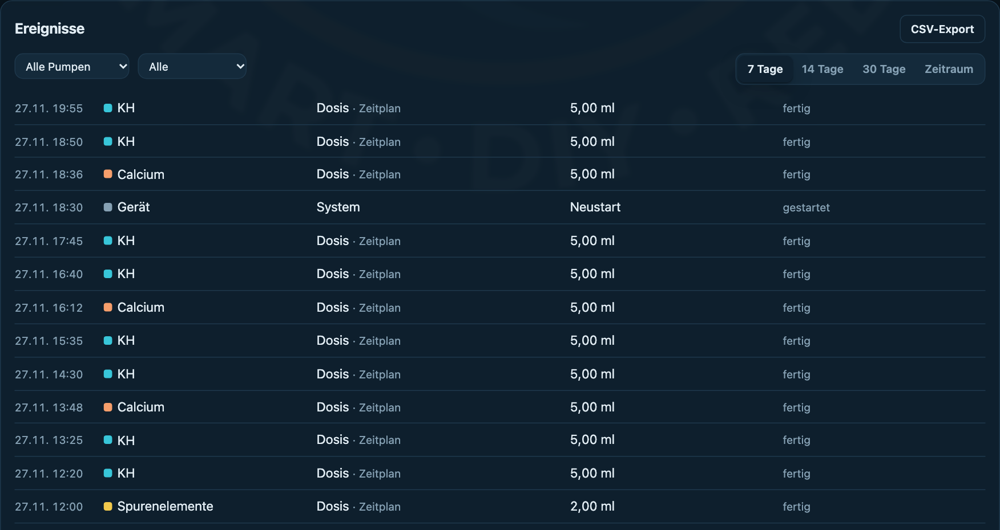

## 8. Einstellungen

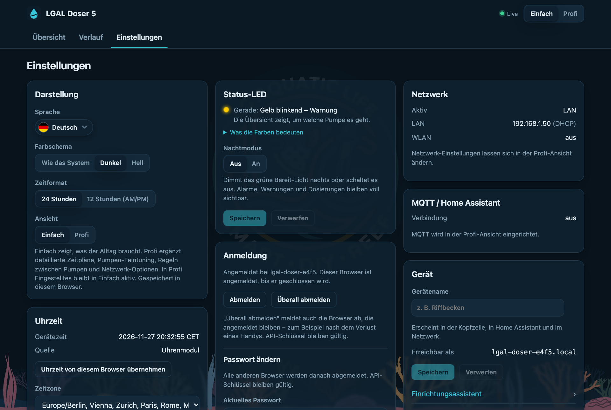

| Bereich | Inhalt |
|---|---|
| Gerät | Gerätename (z. B. „Riffbecken“); daraus folgt die Adresse, z. B. `riffbecken.local` |
| Uhrzeit | Gerätezeit und Quelle, Zeitzone, Uhrzeit vom Browser übernehmen; in Profi Zeitserver und Uhrzeit von Hand |
| Status-LED | Bedeutung der Farben, **Nachtmodus**: Bereit-Licht in einem Zeitfenster dimmen oder aus (Alarme bleiben sichtbar) |
| Sperrzeiten (Profi) | Mindestabstand zwischen zwei Pumpen, z. B. KH und Calcium mindestens 30 min auseinander; dazu, ob eine manuelle Dosis in der Sperrzeit abgelehnt wird, wartet oder nachfragt |
| Netzwerk | Status; in Profi LAN/WLAN, feste Adressen, WLAN suchen und testen |
| MQTT (Profi) | Anbindung an Home Assistant oder einen anderen MQTT-Broker, wahlweise mit Steuerung aus Home Assistant |
| Anmeldung | Passwort ändern, abmelden, überall abmelden; in Profi API-Schlüssel für Apps und Skripte |
| Darstellung | dunkel, hell oder wie das System; Sprache; 24- oder 12-Stunden-Format |

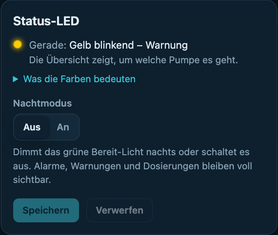
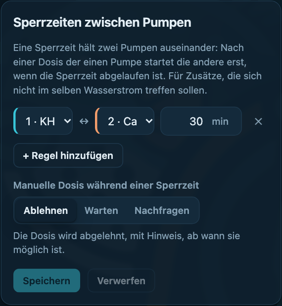

**Home Assistant:** Broker-Adresse eintragen und „Home-Assistant-Erkennung“ einschalten; das
Gerät erscheint dann von selbst mit Sensoren für jede Pumpe. „Steuerung über MQTT erlauben“
ermöglicht Dosieren und Schalten aus Home Assistant – nur einschalten, wenn der Broker
geschützt ist.

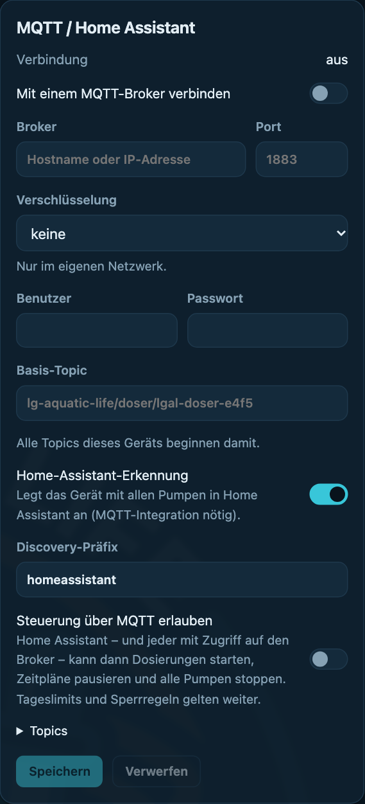

## 9. Updates und Wartung

Einstellungen → **Wartung**:

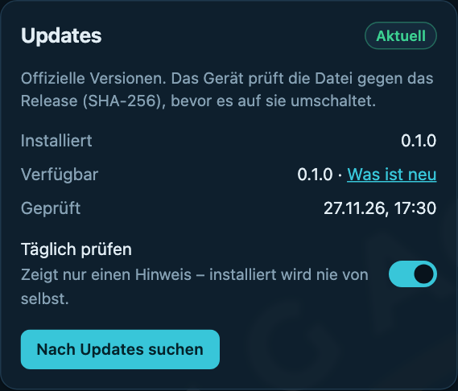

- **Updates:** Ist eine Update-Quelle eingerichtet, zeigt die Karte die installierte und die
  neueste Version, prüft auf Wunsch täglich und installiert per Knopfdruck. Installiert wird
  nie ohne Auftrag.
- **Update-Kanal** (nur Profi-Ansicht): **Stabil** bekommt nur fertige Versionen. **Beta**
  bietet auch Vorabversionen an – Versionen vor einem Release, die noch nicht vollständig
  getestet sind und Fehler enthalten können, die zu Fehldosierungen führen. Nur auf Beta
  wechseln, wer testen will und weiß, worauf er sich einlässt, und nach einem Update die
  Wasserwerte öfter messen. Zurück auf Stabil behält das Gerät die Vorabversion, bis eine neuere
  fertige Version erscheint; wer sofort zurück will, lädt die Datei der fertigen Version hoch.
- **Firmware-Datei hochladen:** eine `.bin`-Datei passend zum Modul des Geräts.
- Während eines Updates und solange eine Pumpe läuft, ist das Update gesperrt bzw. die Pumpen
  stehen. Startet die neue Firmware nicht sauber, kehrt das Gerät **von selbst zur alten
  Version zurück**; die Wartungsseite zeigt dann einen Hinweis.
- **Neustart** und **Werkseinstellungen** (mit erneuter Eingabe des Admin-Passworts).
- Lizenzen der Firmware und der enthaltenen Fremdsoftware.

Nach einem Update: kurz prüfen, ob Zeitpläne und Mengen stimmen.

## 10. Taster und Status-LED

Der Taster sitzt am Gehäuse. Gezählt wird beim Loslassen:

| Halten | Wirkung | LED beim Halten |
|---|---|---|
| 3 Sekunden | Setup-WLAN für 30 Minuten (Netzwerk reparieren, Passwort zurücksetzen) | weiß |
| 10 Sekunden | **Werkseinstellungen:** löscht alle Einstellungen, Zeitpläne, Kalibrierungen und den Verlauf | rot |

Beim Einstecken des Netzteils den Taster **nicht** gedrückt halten – sonst startet der Chip im
Programmiermodus statt mit der Firmware.

Die LED zeigt immer den wichtigsten Zustand:

| LED | Bedeutung |
|---|---|
| rot, schnell blinkend | Alarm (Tageslimit, Treiberfehler, Uhrenmodul, keine 24-V-Versorgung) |
| weiß, schnell blinkend | Firmware-Update läuft |
| magenta pulsierend | Kalibrieren oder Schlauch füllen |
| blau pulsierend | eine Pumpe läuft |
| weiß, langsam pulsierend | Setup-WLAN an |
| gelb, langsam blinkend | Warnung (Behälter fast leer, Schlauch, kein Netz, keine Uhrzeit, 24-V-Versorgung zu niedrig) |
| grün | bereit, per LAN oder WLAN verbunden |
| weiß aufblendend | Start |

## 11. Wenn etwas nicht geht

**Admin-Passwort vergessen:** Taster 3 Sekunden halten → Setup-WLAN
`LG-Aquatic-Life-Setup-XXXX` mit dem Geräte-Passwort vom Typenschild verbinden →
`http://192.168.4.1/login` öffnen → „Passwort vergessen“, mit dem Geräte-Passwort ein neues
Admin-Passwort setzen. Einstellungen, Zeitpläne und Kalibrierungen bleiben erhalten.

**Gerät nach Netzwerkänderung nicht mehr erreichbar:** Taster 3 Sekunden halten, mit dem
Setup-WLAN verbinden und `http://192.168.4.1/network` öffnen.

**Oberfläche lädt nicht:** Die Notfallseite `http://<Adresse>/recovery` (von Hand eingeben)
bietet Firmware-Upload, Neustart und Log.

| Problem | Mögliche Ursache und Abhilfe |
|---|---|
| Gerät nicht erreichbar | LED gelb blinkend = kein Netz: Kabel, Router, WLAN prüfen. Statt `….local` die IP-Adresse aus dem Router verwenden. |
| „Keine 24-V-Versorgung“ (LED rot) | Nur Platine v1.1: Das Netzteil ist nicht angeschlossen oder ausgefallen; Pumpen, LAN und Uhrenmodul sind aus, das Gerät öffnet sein Einrichtungs-WLAN. Netzteil anschließen, das Gerät startet von selbst neu. „Zu niedrig“ = Netzteil prüfen (24 V). |
| Pumpe dosiert nicht nach Plan | Betrieb „automatisch“? Gültige Uhrzeit? Tageslimit oder Sperrzeit? Der Verlauf (Profi) nennt den Grund jeder ausgelassenen Dosis. |
| Menge stimmt nicht | Schlauch gefüllt? Neu kalibrieren; nach einem Schlauchwechsel immer. Alter Schlauch fördert weniger. |
| Pumpe brummt, dreht aber nicht | Schlauch klemmt oder Pumpenkopf blockiert; Pumpe auf „aus“, prüfen. |
| Uhrzeit nach Stromausfall falsch | Pufferbatterie des Uhrenmoduls leer (Hinweis in Einstellungen → Uhrzeit) oder kein Zeitserver erreichbar. |
| Update lässt sich nicht starten | Läuft eine Pumpe? Passt die Datei zum Modul (Meldung „falsche Variante“)? |
| Nach dem Update wieder alte Version | Die neue Firmware ist nicht sauber gestartet, das Gerät ist zurückgekehrt. Hinweis in der Wartung; Log ansehen. |

Ein Fehler, der sich so nicht lösen lässt? Bitte als Fehlermeldung im Repository melden und
dabei Firmware-Version (Fuß der Seite) und, wenn möglich, das Log aus der Wartung (Profi)
angeben – **ohne Passwörter oder Schlüssel**.

---

Die Nutzung erfolgt auf eigene Verantwortung, siehe [Sicherheit und Haftung](../../README.de.md#sicherheit-und-haftung).
