<!-- SPDX-FileCopyrightText: 2026 Lars Greiss / LG Aquatic Life -->
<!-- SPDX-License-Identifier: GPL-3.0-or-later -->

# LGAL Doser – user guide

*English · [Deutsch](de/benutzer.md)*

This guide explains how to set up and operate the dosing pump in daily use at the aquarium. How
to build the device is described in the [build guide](build-guide.md), technical details (API,
MQTT topics, internals) in the [technical documentation](technical.md).

> **Dosing errors can kill animals.** Please read the [safety](#1-safety) section before first
> use, and always check new settings first without animals or with small amounts and frequent
> water tests.

## Contents

1. [Safety](#1-safety)
2. [Placing and connecting](#2-placing-and-connecting)
3. [Initial setup](#3-initial-setup)
4. [Signing in](#4-signing-in)
5. [The web UI](#5-the-web-ui)
6. [Setting up a pump](#6-setting-up-a-pump)
7. [Daily use](#7-daily-use)
8. [Settings](#8-settings)
9. [Updates and maintenance](#9-updates-and-maintenance)
10. [Button and status LED](#10-button-and-status-led)
11. [When something does not work](#11-when-something-does-not-work)

---

## 1. Safety

- **Limit the amounts:** set a daily limit for every pump (pro view, pump → settings) that safely
  rules out a dangerous amount. Do not use larger containers than needed.
- **Check:** after every change to tube, container, schedule or firmware, calibrate the pump
  again or check the amount, and test the water more often in the following days.
- **Route the tubes correctly:** fix the tube ends in the tank above the water level or use a
  check valve, so that nothing flows back or keeps running. Do not swap tubes – seen from the
  front, pump 1 is the left one.
- **Power and water:** place device and power supply protected from splash water and above the
  tank, lay cables with a drip loop, and plug the power supply into a socket protected by a
  residual current device (RCD). Use only the intended 24 V power supply.
- **Before working on the device** (changing a tube, replacing a pump) set the pump's mode to
  "off" or unplug the power supply.

## 2. Placing and connecting

1. Place the device above the water level, the containers next to or below it.
2. For each pump, put the suction tube into the container and fix the end of the delivery tube
   at the tank (see above). The pumps are numbered on the enclosure.
3. Plug in the LAN cable (recommended). Wi-Fi works too, but is only chosen during the setup.
4. Connect the power supply last. The LED fades in white and then shows what the device is doing
   (see [status LED](#10-button-and-status-led)).

The **rating plate** of the device shows the name of the setup Wi-Fi and the **device
password**. Both are needed for the setup and in an emergency – do not remove the rating plate.

## 3. Initial setup

A new device opens its own Wi-Fi for this, the setup Wi-Fi (LED pulsing white, slowly).

1. On a phone or laptop, choose the Wi-Fi **`LG-Aquatic-Life-Setup-XXXX`** and enter the device
   password from the rating plate.
2. Usually the setup opens by itself. Otherwise open `http://192.168.4.1/` in the browser.
3. The wizard guides you through five steps:
   - **language** (English, German, French, Spanish, Italian, Dutch, Polish, Turkish or
     Chinese),
   - **own admin password** (8–64 characters): enter the device password from the rating plate
     once, then choose your own password – from now on only this one signs in,
   - **sign in** once with the new password (user "admin"); your browser can remember it now.
     Then the setup goes on with
   - **network:** check the LAN status or scan, test and save a Wi-Fi,
   - **time zone** and time server, if needed take the time from the browser,
   - **finish.**

   Until the setup is finished the device does nothing else – no pump can be started. If you
   stop in between, you get back to the setup after signing in.
4. After finishing, the page shows the new address of the device, e.g.
   `http://lgal-doser-xxxx.local/`, and the IP address. 20 seconds later the setup Wi-Fi switches
   off. Connect phone or laptop to the home network again and open the new address.

The setup step by step:

<table>
<tr>
<td align="center" width="33%">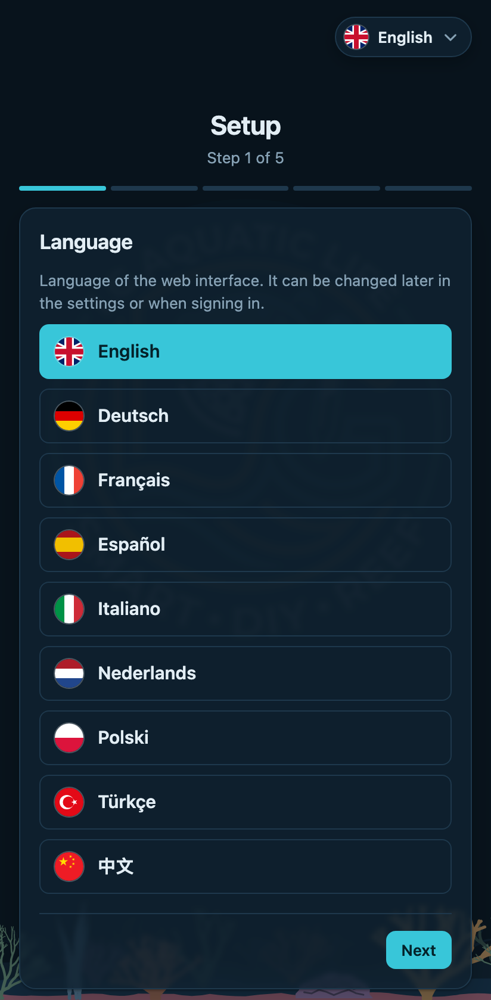 1. Language</td>
<td align="center" width="33%">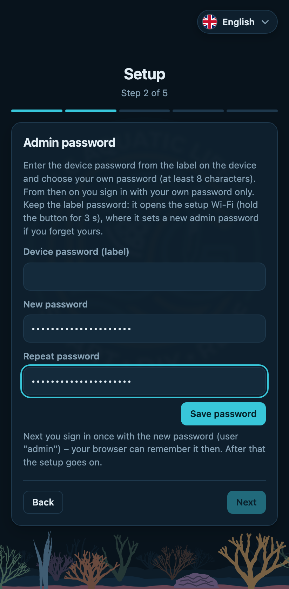 2. Own password</td>
<td align="center" width="33%">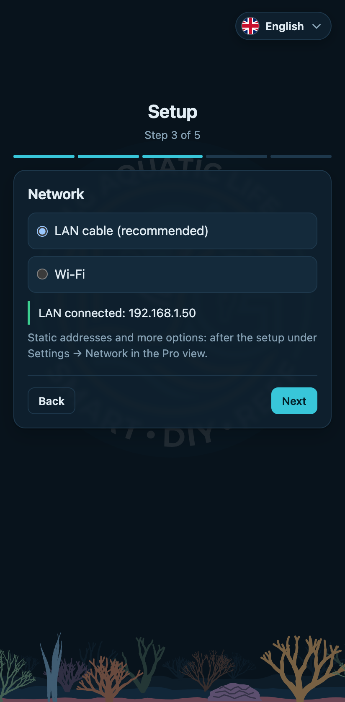 3. Network (LAN)</td>
</tr>
<tr>
<td align="center" width="33%">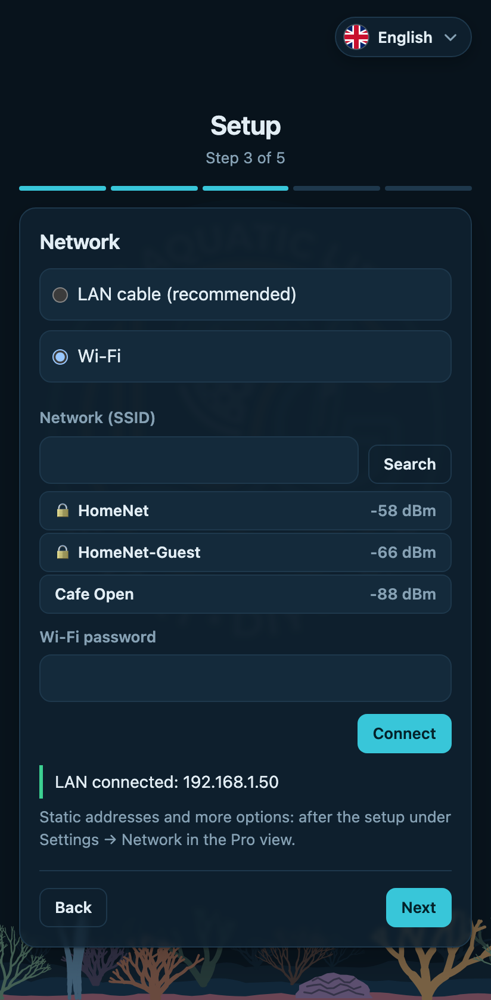 3. Network (Wi-Fi)</td>
<td align="center" width="33%">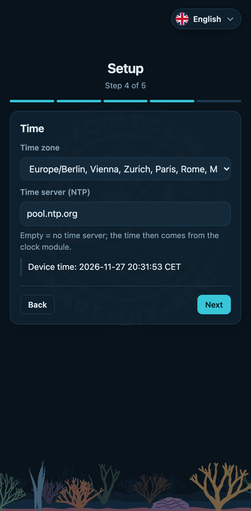 4. Time zone</td>
<td align="center" width="33%">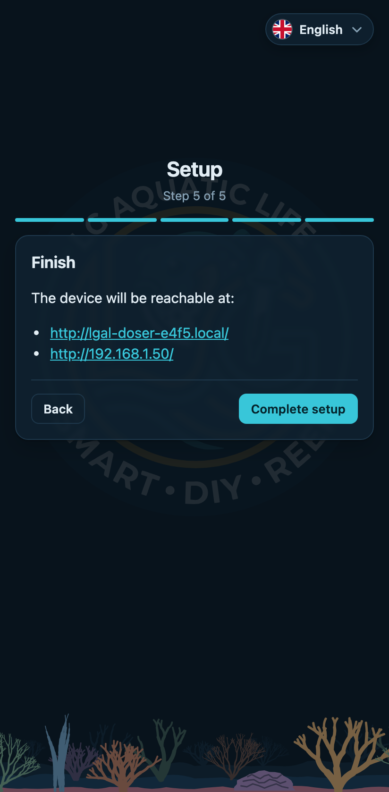 5. Finish</td>
</tr>
</table>

Tip: bookmark the address, or add it to the home screen of your phone (it gets the drop icon
there). If `….local` does not work (some Android devices), use the IP address; it is also listed
in the router's device list.

## 4. Signing in

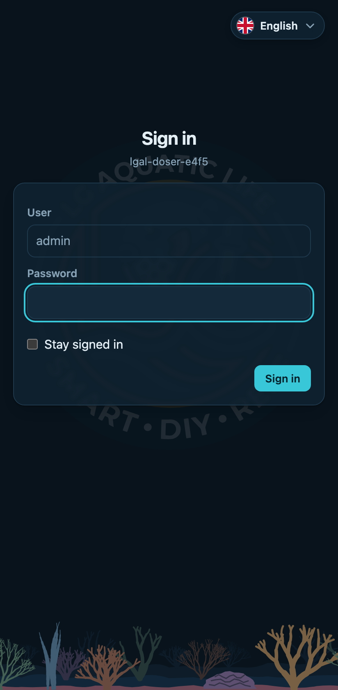

- You sign in as user **admin** with your own **admin password**. The browser stays signed in as long as it is used
  at least once a week (at most 30 days) and is not closed. After a restart or update of the
  device you have to sign in again.
- With **Stay signed in** the browser stays signed in for 90 days after the last visit, also
  when it is closed and after a restart or update. Only tick it on your own devices.
- **Sign out everywhere** (settings → sign-in) signs out every browser, for example after losing
  a phone. Apps and Home Assistant with an API key stay connected.
- After five wrong attempts the device waits before every further attempt, briefly at first,
  then longer and longer (up to 5 minutes).
- **Forgotten password:** see [When something does not work](#11-when-something-does-not-work).
- Change password, sign out and sign out everywhere: settings → sign-in.

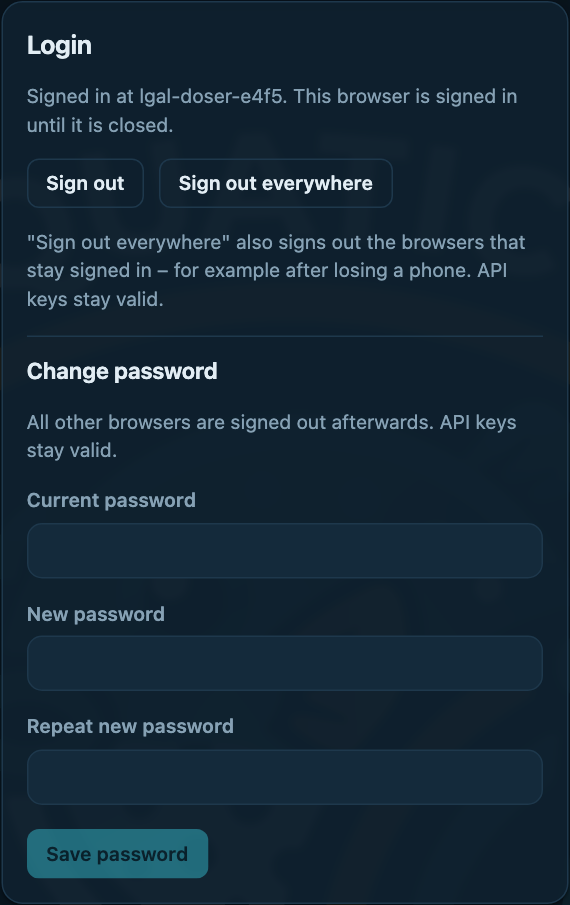

## 5. The web UI

At the top right you choose the view:

- **Simple** shows everything needed in daily use.
- **Pro** additionally shows detailed schedules, fine-tuning of the pumps, lock times between
  pumps, network and MQTT settings, the event list and API keys.

What is set in pro stays active in simple. The view is remembered per browser.

The pages:

| Page | Content |
|---|---|
| **Overview** | one card per pump with container, dosed / planned today, range and next dose |
| **Pump** (tap a card) | container, alarms and warnings, dose now, calibration (with filling the tube), schedule, boost, consumption, settings |
| **History** | dosed amounts per day as a chart; in pro all events with filter and CSV export |
| **Settings** | device, time, status LED, network, MQTT, sign-in, appearance; from here to **maintenance** |

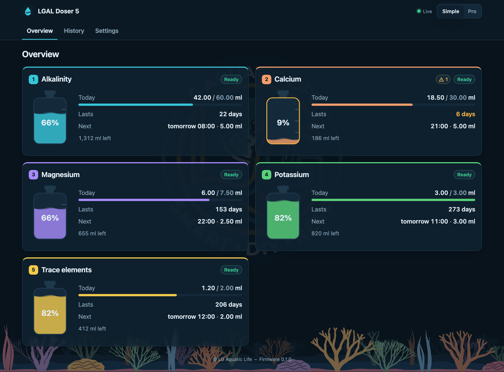

A pump card in the overview:

- **Container graphic:** level in percent. The border turns **yellow** when the stock lasts fewer
  days than the warning threshold (default 7 days), and **red** below the alarm threshold
  (default 4 days). Dashed = no container tracking.
- **Today:** already dosed / planned for today. Turquoise during a boost.
- **Lasts:** how many days the stock still lasts with the current schedule.
- **Next:** time and amount of the next scheduled dose.
- **Icons next to the status:** number of alarms (red) and warnings (yellow), an arrow during a
  boost. The texts are on the pump page.

## 6. Setting up a pump

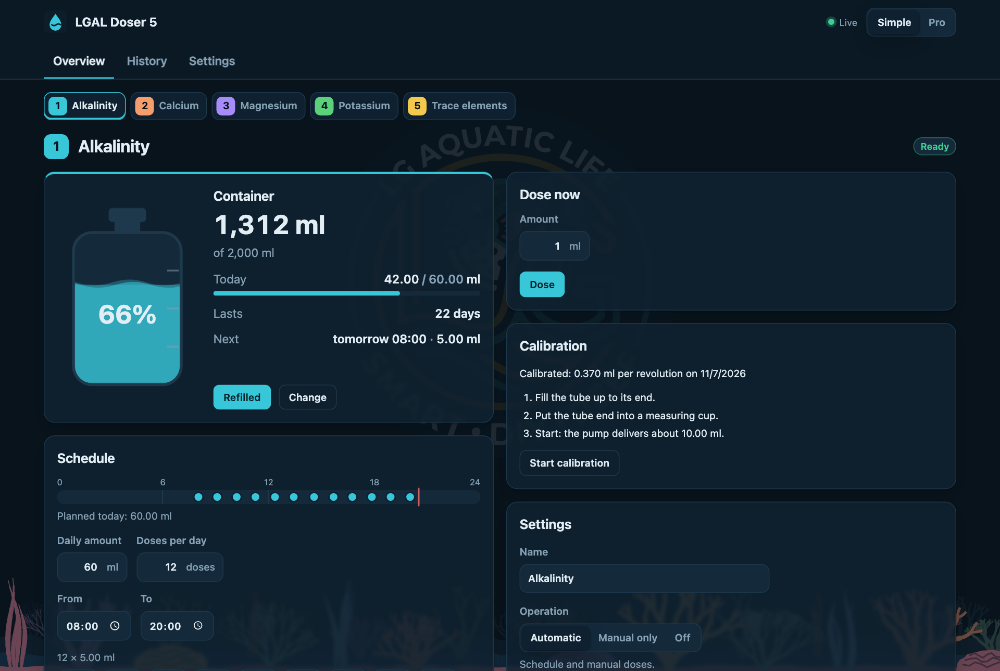

For every pump, in this order:

### 6.1 Name and mode

Pump → settings: **name** (e.g. "Alkalinity", "Calcium") and **mode**:

| Mode | Meaning |
|---|---|
| automatic | the schedule runs, dosing by hand works too |
| manual only | no schedule, only dosing by hand |
| off | the pump does not run at all and reports no alarms |

### 6.2 Entering the container

On the container card, **Change**: size of the container in ml. A newly entered container counts
as full. After refilling, **Refilled** is enough (or **Change** if the container is not quite
full). Size 0 switches the container tracking off.

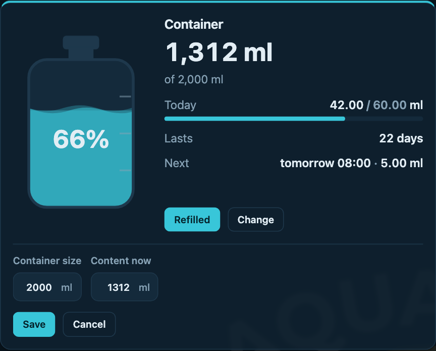

The device subtracts every dose and the calibration from the container and
computes the range from it. The level is a calculation and only as accurate as calibration and
entries. When the stock runs low, the range turns yellow and the pump warns, see
[Alarms and warnings](#alarms-and-warnings).

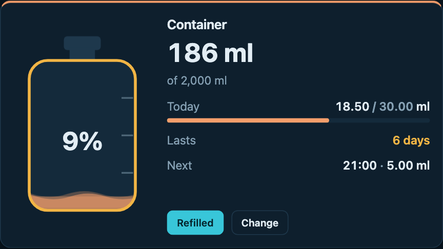

### 6.3 Filling the tube

Calibration → **Start calibration** opens the wizard; there keep **Hold to fill** pressed until
the liquid reaches the end of the tube. The pump only runs while the button is held and stops at
once on release or when the connection drops (at most 60 seconds in one go). To fill only,
close the wizard with **Cancel** afterwards. There is no button for it elsewhere, so that
nobody runs a pump by accident.

### 6.4 Calibrating

Without calibration the pump works with a nominal value that can differ considerably depending on
the tube. **So calibrate every pump before use.**

1. **Start calibration**. The wizard asks whether the tube is primed and offers filling right
   there.
2. Hold the tube end into a measuring cup (ideally a syringe or measuring cylinder with 0.1 ml
   graduation). The pump delivers the target amount (default 10 ml).
3. Enter the **amount actually measured** and apply it – or discard it.

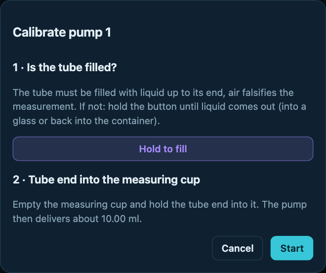

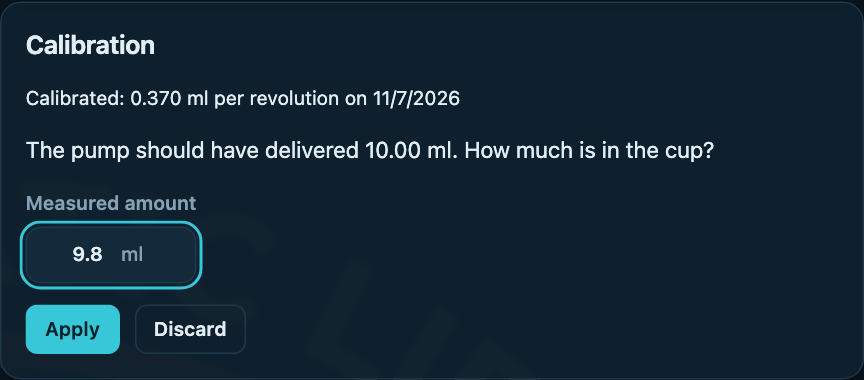

The pump reminds you to calibrate again (configurable: off, 3, 6, 9 or 12 months, default 3).
Always calibrate again after a tube change.

### 6.5 Schedule

Every pump has exactly one schedule. The 24-hour bar shows today's doses.

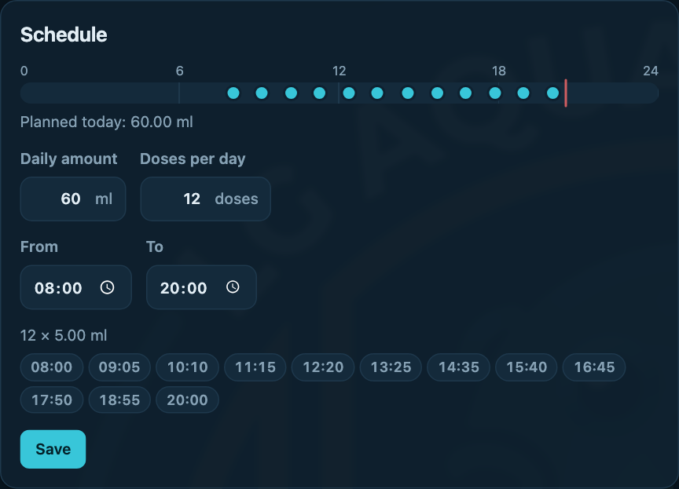
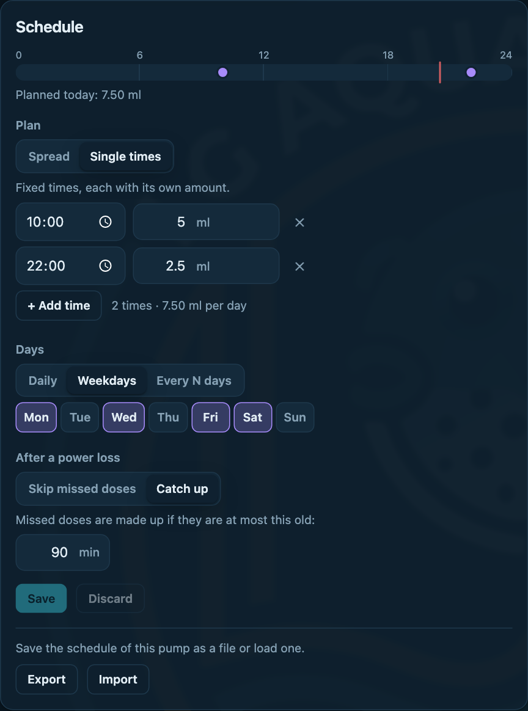

- **Simple:** daily amount, number of doses and two times, e.g. "24 ml in 12 doses between 08:00
  and 20:00", daily. The preview shows the times.
- **Pro:** additionally "single times" (up to 24 times with their own amount), weekdays or "every
  N days" and the behaviour after a power cut (skip missed doses or catch them up within a time
  window).

On save the device checks all pumps together: doses must not overlap, exceed the daily limit or
violate a lock time. Conflicts are reported with the time; nothing is saved then.

A schedule only runs in mode **automatic** and only with a valid time. In pro it can be exported
as a file and imported on the same or another pump.

### 6.6 Fine-tuning (pro)

Pump → settings in pro:

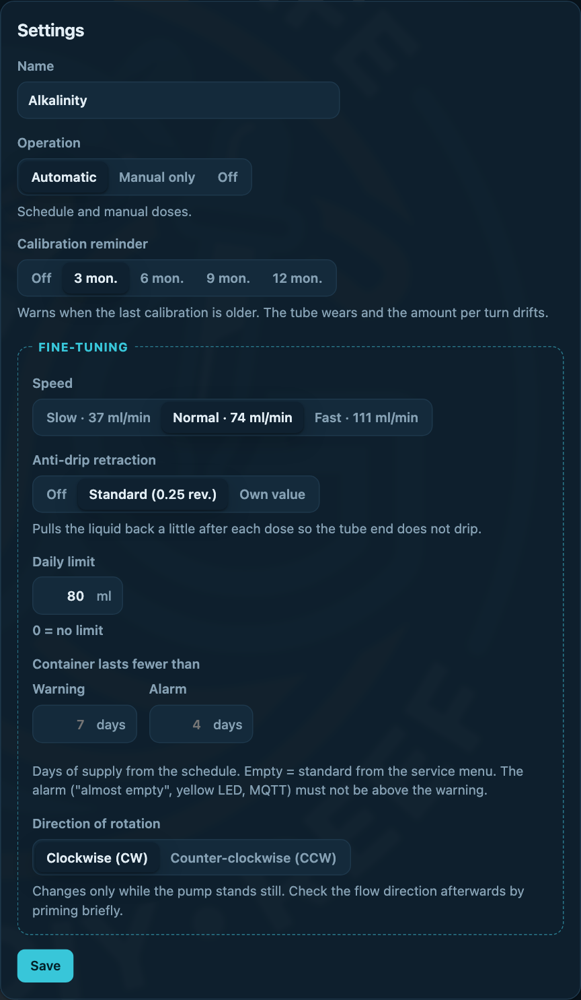

- **Daily limit:** hard upper limit per day for all doses together. A dose that would go beyond
  it is skipped and reported. **Strongly recommended.**
- **Speed** when dosing (three tiers).
- **Retract:** pulls back a little after every dose so that nothing drips (off by default).
- **Warning and alarm threshold** of the container in days of range.
- **Direction of rotation** seen from the front, clockwise from the factory, if the pump delivers
  the wrong way round (only at standstill; then fill briefly in the calibration wizard and check the direction).

The target amount of the calibration can be changed in pro directly in the calibration wizard.

### 6.7 Changing the tube

Pump tubes wear out. The device counts the operating hours per pump (pump → consumption) and warns when
the tube life is reached. After the change, press **Tube replaced** in pro and calibrate the pump
again.

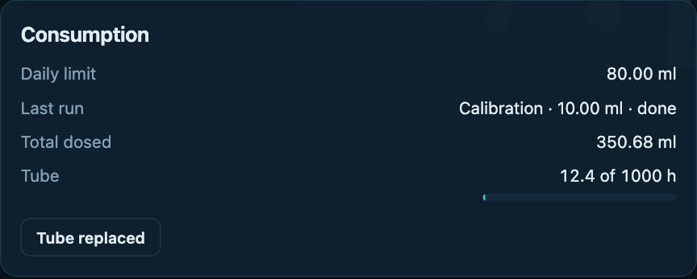

## 7. Daily use

### Dose now

Pump → **Dose now**: enter an amount, start; progress and **Stop** are shown. If the pump is in a
lock time right now, the page names when it is possible again, or the dose starts afterwards,
depending on the setting. With **Ask** you choose: cancel, dose when the lock time ends, or dose
anyway (the history notes it).

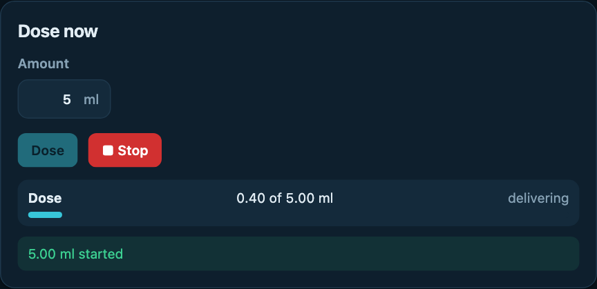

### Boost

Dose more for a limited time, e.g. after a water change: pump → **Boost**, choose the extra amount
and the period (1–30 days). The amount is spread evenly over the scheduled doses; the preview
shows "≈ X ml extra per day". In pro "over the next N doses" is possible too. A boost ends by
itself and can be ended earlier. It needs a schedule and mode "automatic".

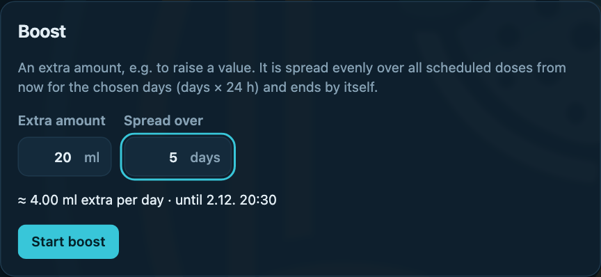

### Alarms and warnings

| Message | Meaning, what to do |
|---|---|
| Container almost empty | the stock lasts only a few more days → refill |
| Daily limit reached | a dose was skipped → check schedule and limit |
| Driver fault in the last run | check motor or cable; if it happens again: set the pump to "off" |
| Calibration missing / too old | calibrate the pump |
| New tube – calibrate again | after "Tube replaced" |
| Tube life reached | replace the pump tube |
| Skipped doses | e.g. after a power cut; the reason is in the history |
| No valid time | schedules pause; check network/time server or set the time |

### History

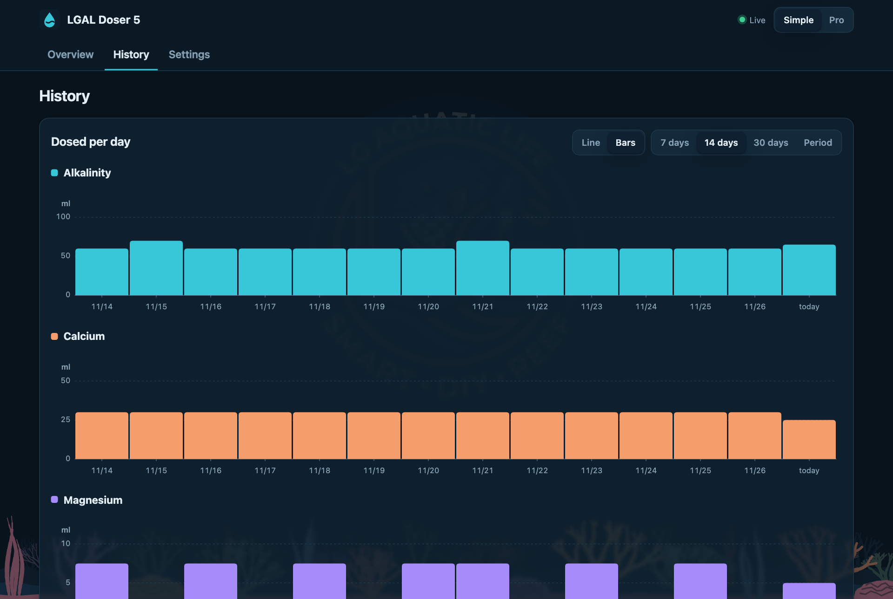

**History** shows the dosed amount per day and pump for 7, 14 (default) or 30 days, or with
**Period** for any days the device still keeps (from – to; 30 to 90 days, set in the
engineering area), as bars or line. Tapping a day names amount, number of doses and skipped doses. In pro there is
the list of all events (doses, tube filling, calibration, alarms, changes …) with filter and CSV
export.

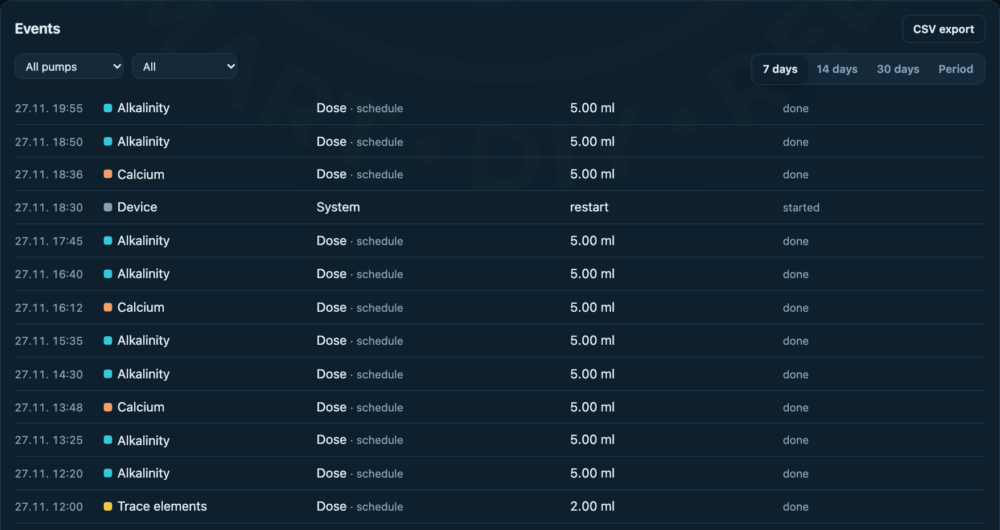

## 8. Settings

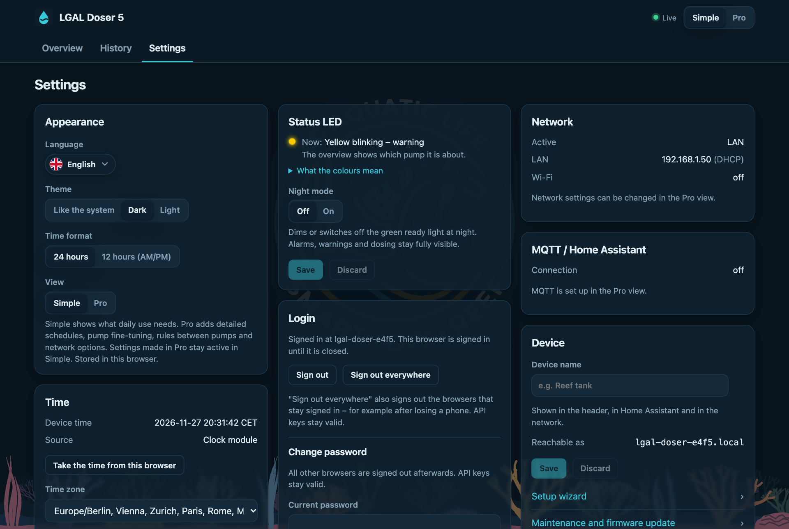

| Area | Content |
|---|---|
| Device | device name (e.g. "Reef tank"); the address follows from it, e.g. `reef-tank.local` |
| Time | device time and source, time zone, take the time from the browser; in pro time server and time by hand |
| Status LED | meaning of the colours, **night mode**: dim the ready light in a time window or switch it off (alarms stay visible) |
| Lock times (pro) | minimum gap between two pumps, e.g. alkalinity and calcium at least 30 min apart; plus whether a manual dose during a lock time is rejected, waits or asks |
| Network | status; in pro LAN/Wi-Fi, static addresses, scan and test Wi-Fi |
| MQTT (pro) | connection to Home Assistant or another MQTT broker, optionally with control from Home Assistant |
| Sign-in | change password, sign out, sign out everywhere; in pro API keys for apps and scripts |
| Appearance | dark, light or as the system; language; 24- or 12-hour format |

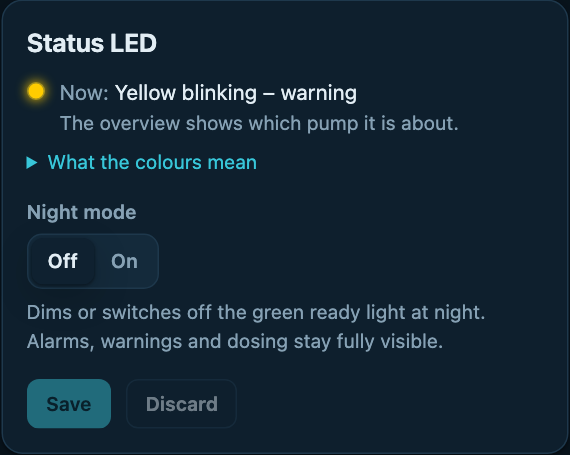
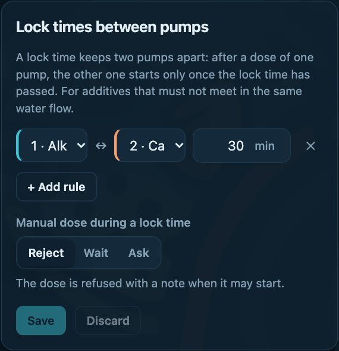

**Home Assistant:** enter the broker address and switch on "Home Assistant discovery"; the device
then appears by itself with sensors for every pump. "Allow control via MQTT" enables dosing and
switching from Home Assistant – only switch it on if the broker is protected.

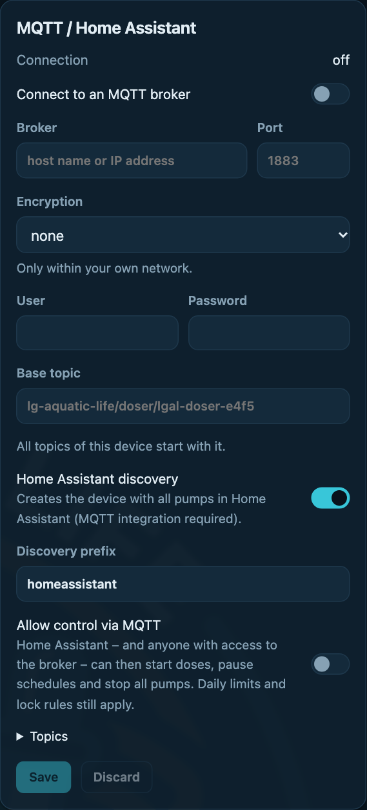

## 9. Updates and maintenance

Settings → **Maintenance**:

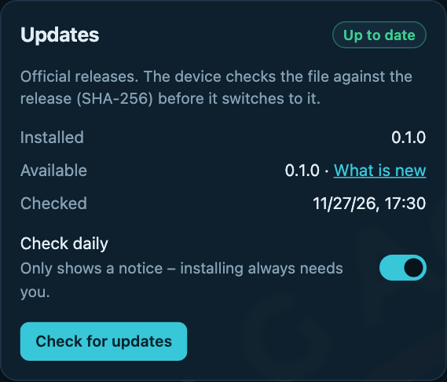

- **Updates:** if an update source is set up, the card shows the installed and the newest
  version, checks daily if you like and installs at the press of a button. Nothing is ever
  installed without an order.
- **Update channel** (pro view only): **Stable** gets releases only. **Beta** also offers
  release candidates – versions before a release that are not fully tested yet and may contain
  bugs that lead to wrong doses. Only switch to beta if you want to test and know what you are
  letting yourself in for, and test the water more often after an update. Back on stable the
  device keeps the release candidate until a newer release is out; to go back at once, upload
  the release file.
- **Upload a firmware file:** a `.bin` file matching the module of the device.
- During an update and while a pump runs, the update is locked or the pumps stand still. If the
  new firmware does not start cleanly, the device **returns to the old version by itself**; the
  maintenance page then shows a hint.
- **Restart** and **factory reset** (with the admin password entered again).
- Licenses of the firmware and the included third-party software.

After an update: briefly check that schedules and amounts are right.

## 10. Button and status LED

The button sits on the enclosure. It counts on release:

| Hold | Effect | LED while holding |
|---|---|---|
| 3 seconds | setup Wi-Fi for 30 minutes (repair the network, reset the password) | white |
| 10 seconds | **factory reset:** erases all settings, schedules, calibrations and the history | red |

Do **not** hold the button while plugging in the power supply – otherwise the chip starts in
programming mode instead of the firmware.

The LED always shows the most important state:

| LED | Meaning |
|---|---|
| red, fast blinking | alarm (daily limit, driver fault, clock module, no 24 V supply) |
| white, fast blinking | firmware update running |
| magenta pulsing | calibrating or filling the tube |
| blue pulsing | a pump is running |
| white, slowly pulsing | setup Wi-Fi on |
| yellow, slow blinking | warning (container almost empty, tube, no network, no time, 24 V supply too low) |
| green | ready, connected via LAN or Wi-Fi |
| white fading in | start |

## 11. When something does not work

**Admin password forgotten:** hold the button for 3 seconds → connect to the setup Wi-Fi
`LG-Aquatic-Life-Setup-XXXX` with the device password from the rating plate → open
`http://192.168.4.1/login` → "Forgot password", set a new admin password with the device
password. Settings, schedules and calibrations are kept.

**Device unreachable after a network change:** hold the button for 3 seconds, connect to the
setup Wi-Fi and open `http://192.168.4.1/network`.

**Web UI does not load:** the emergency page `http://<address>/recovery` (type it by hand)
offers firmware upload, restart and log.

| Problem | Possible cause and remedy |
|---|---|
| Device unreachable | LED blinking yellow = no network: check cable, router, Wi-Fi. Use the IP address from the router instead of `….local`. |
| "No 24 V supply" (LED red) | Board v1.1 only: the power supply is not connected or has failed; pumps, LAN and clock module are off, the device opens its setup Wi-Fi. Connect the power supply, the device restarts by itself. "Too low" = check the power supply (24 V). |
| Pump does not dose as planned | Mode "automatic"? Valid time? Daily limit or lock time? The history (pro) names the reason of every skipped dose. |
| Amount is wrong | Tube primed? Calibrate again; always after a tube change. An old tube delivers less. |
| Pump hums but does not turn | Tube stuck or pump head blocked; set the pump to "off" and check. |
| Time wrong after a power cut | Backup battery of the clock module flat (hint in settings → time) or no time server reachable. |
| Update cannot be started | Is a pump running? Does the file match the module (message "wrong variant")? |
| Old version again after the update | The new firmware did not start cleanly, the device went back. Hint on the maintenance page; look at the log. |

A problem you cannot solve like this? Please report it as an issue in the repository, with the
firmware version (footer of the page) and, if possible, the log from the maintenance page (pro) –
**without passwords or keys**.

---

Use at your own risk, see [Safety and liability](../README.md#safety-and-liability).
